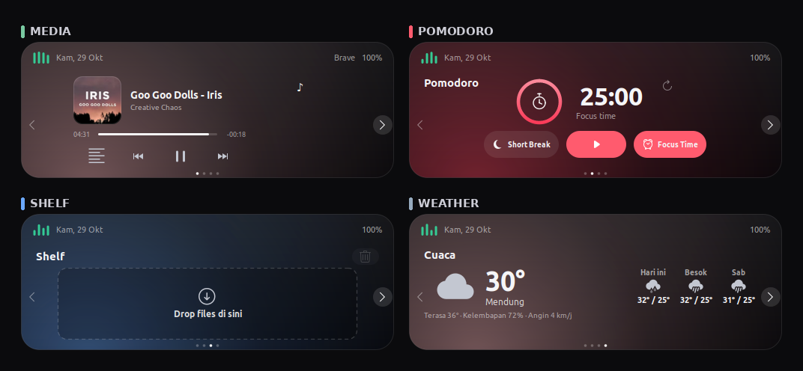
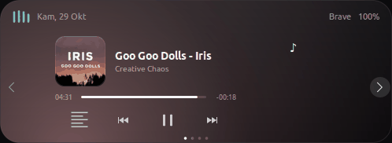

# Zenon

A lightweight Dynamic Island-style overlay for Linux, built with Python, GTK 3, and Cairo.


## Overview

Zenon keeps a compact pill at the top of your screen. Hover over it and it expands into a control panel with four slides: media, Pomodoro timer, file shelf, and weather. The app draws its own rounded window with Cairo, talks to media players over MPRIS/DBus, and stores its state in your user cache directory.

The project is a single Python file built on GTK 3 and Cairo. It targets X11 desktops and was tested on Linux Mint 21.3 MATE with GTK 3.24 and Python 3.10. Wayland is not supported because the app relies on X11 window shaping and global pointer queries.

## Demo





The composite image shows all four slides: media, Pomodoro, shelf, and weather. The GIF cycles through them.

## Features

- **Compact overlay**: clock, date, battery status, media equalizer, and animated eyes in a 190x42 pill.
- **Hover to expand**: smooth Cairo animation to a 498x182 panel; collapses when the pointer leaves.
- **Media control**: MPRIS support for Spotify, VLC, Rhythmbox, browsers with MPRIS support, and other players. Album art, title, artist, progress, play/pause, previous, and next.
- **Synced lyrics**: click the track info to open lyrics mode. Lyrics come from LRCLIB.
- **Pomodoro timer**: 25-minute focus and 5-minute break modes, progress ring, start/pause, and reset.
- **File shelf**: drag files or folders onto the pill. Open items with xdg-open, remove individual items, or clear the shelf. Up to 60 items persist across restarts.
- **Weather**: current conditions, feels-like temperature, humidity, wind, and a 3-day forecast from Open-Meteo. Configurable coordinates and a 30-minute cache.
- **Navigation**: four slides with arrow buttons, horizontal swipe, and page dots.
- **Single instance**: a lock file prevents duplicate overlays.
- **No API keys**: weather and lyrics use public endpoints. No account or token is required.

## Prerequisites

- Linux with an X11 session. Wayland is not supported.
- A compositing window manager for transparency and rounded corners.
- Python 3.8 or newer. Tested with Python 3.10.12.
- GTK 3.24 or newer.
- Debian, Ubuntu, or Linux Mint packages:

```bash
sudo apt update
sudo apt install python3 python3-venv python3-gi python3-gi-cairo \
  gir1.2-gtk-3.0 python3-cairo python3-dbus libx11-6 xdg-utils
```

- Optional: an MPRIS-compatible media player for the media slide.
- Network access for weather and lyrics.

## Installation

Clone the repository and enter it:

```bash
git clone https://github.com/sixrex-gx/zenon.git
cd zenon
```

Create a virtual environment that can see the system GTK bindings:

```bash
python3 -m venv --system-site-packages .venv
source .venv/bin/activate
python3 -m pip install --upgrade pip
python3 -m pip install -r requirements.txt
```

Run the app:

```bash
python3 island.py
```

The `--system-site-packages` flag lets the virtual environment use the PyGObject, pycairo, and dbus-python packages installed by your distribution. If you prefer an isolated environment, install the build headers first:

```bash
sudo apt install libgirepository1.0-dev libcairo2-dev libdbus-1-dev \
  libglib2.0-dev pkg-config python3-dev
python3 -m venv .venv
source .venv/bin/activate
python3 -m pip install -r requirements.txt
```

`DISPLAY` must be set and the app must run inside your X11 session.

### Autostart (optional)

Create `~/.config/autostart/zenon.desktop` with:

```ini
[Desktop Entry]
Type=Application
Name=Zenon
Comment=Zenon, a Dynamic Island-style overlay for Linux
Exec=/absolute/path/to/zenon/.venv/bin/python /absolute/path/to/zenon/island.py
Icon=media-playback-start-symbolic
Terminal=false
StartupNotify=false
X-GNOME-Autostart-enabled=true
X-MATE-Autostart-enabled=true
X-GNOME-Autostart-Delay=3
```

Replace the paths with your clone location. The app starts in the background and does not open a terminal.

## Configuration

### Weather location

Create `~/.config/dynamic-island/weather.json`:

```json
{
  "city": "Jakarta",
  "lat": -6.2088,
  "lon": 106.8456
}
```

`city` is a label used in the interface. `lat` and `lon` are sent to Open-Meteo. Replace the example values with your own city. The app reads this file at startup. If the file is missing, the weather slide shows "Lokasi belum diatur".

Weather data is cached for 30 minutes in `~/.cache/dynamic-island-weather.json`. Delete the cache file to force a refresh.

### Visual and layout options

The main constants live at the top of `island.py`:

| Constant | Purpose |
| --- | --- |
| `COMPACT_W`, `COMPACT_H` | Collapsed pill size |
| `EXPANDED_W`, `EXPANDED_H` | Expanded panel size |
| `TOP_MARGIN` | Distance from the top of the work area |
| `ANIM_MS` | Animation frame interval |
| `CLOSE_SECONDS`, `CLOSE_FADE` | Collapse animation timing |
| `SHELF_MAX` | Maximum number of shelf items |
| `WEATHER_TTL` | Weather cache lifetime in seconds |
| `SLIDE_ORDER` | Slide order |

Colors, font sizes, and spacing are defined in the `CSS` block in the same file. The timer accent is `#ff5b6e`; the shelf glow is a light blue. The timer durations are set in `set_timer_mode()`: 25 minutes for focus and 5 minutes for break.

### Data files

| Path | Purpose |
| --- | --- |
| `~/.cache/dynamic-island-shelf.json` | Saved shelf items |
| `~/.cache/dynamic-island-weather.json` | Weather cache |
| `~/.cache/dynamic-island.lock` | Single-instance lock |

The app keeps the original `dynamic-island` data paths for backward compatibility.

The app reads `DISPLAY` and uses the standard XDG directories for config and cache. If `XDG_CONFIG_HOME` or `XDG_CACHE_HOME` is set, the paths above move accordingly.

## Project Structure

```text
.
├── assets/
│   ├── .gitkeep
│   ├── demo.gif
│   └── screenshot.png
├── .gitignore
├── LICENSE
├── README.md
├── island.py
└── requirements.txt
```

## Contributing

1. Fork the repository.
2. Create a branch: `git checkout -b feature/my-feature`.
3. Make your changes.
4. Check the syntax: `python3 -m py_compile island.py`.
5. Commit your changes and push the branch.
6. Open a pull request. Include a screenshot or short recording for UI changes.

Open an issue before large changes so the approach can be discussed first. The project is intentionally a single file; keep that structure unless there is a clear reason to split it.

## Credits

Weather data by [Open-Meteo](https://open-meteo.com/). Lyrics by [LRCLIB](https://lrclib.net/). Built with [GTK](https://www.gtk.org/) and [PyGObject](https://pygobject.gnome.org/).

## License

Released under the MIT License. Copyright (c) 2026 sixrex-gx. See [LICENSE](LICENSE).

Zenon is an independent project and is not affiliated with Apple Inc.
